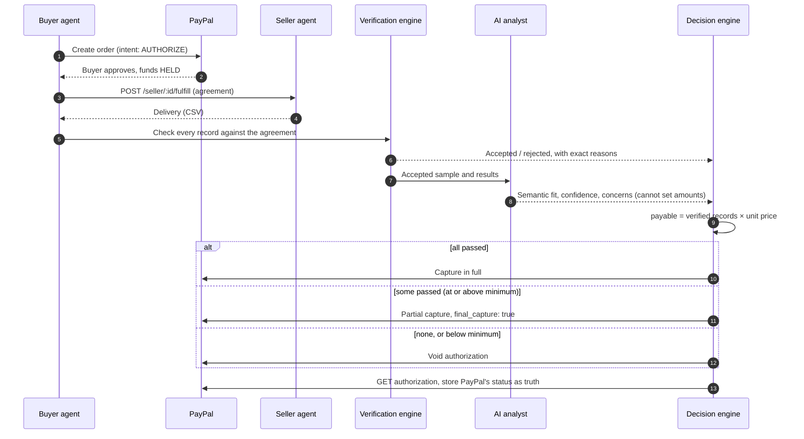
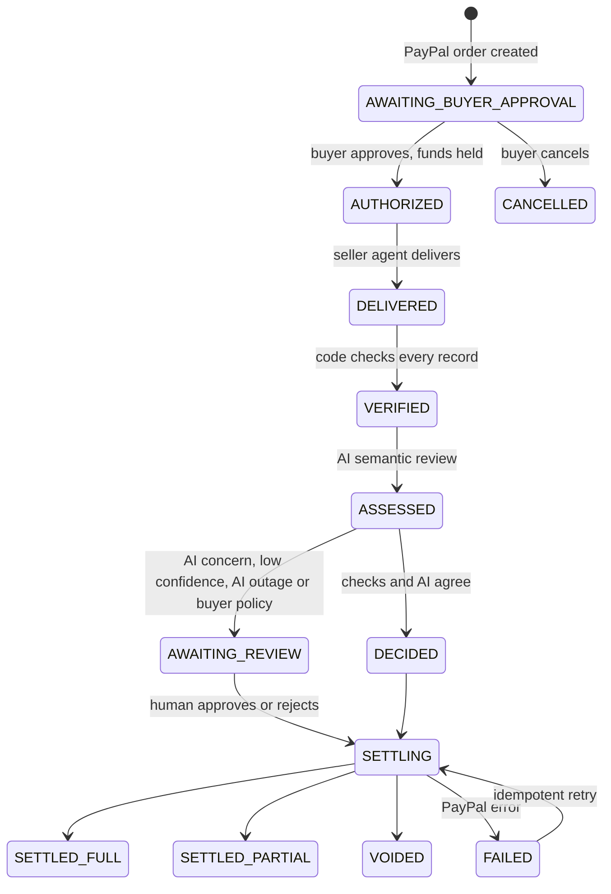

<div align="center">

# AgentKee

### AI agents should pay for what was delivered, not just what was promised.

AgentKee is a payment-control layer for autonomous AI purchases on **PayPal**.<br>
PayPal holds the agent's payment. AgentKee verifies the delivery against the agreement.<br>
The seller is paid for exactly what passed, and the rest goes back to the buyer.

[](LICENSE)


**[Demo video](#) · [Live demo](#) · [How it works](#how-it-works) · [Run it locally](#run-it-locally) · [Roadmap](#post-hackathon-milestones)**

</div>


---

## The problem

AI agents are starting to spend money on our behalf. They buy datasets, API calls, generated content and freelance work. But when an agent pays, nothing checks that it got what it paid for:

- **Payment success doesn't mean delivery success.** A seller can return incomplete, duplicated or fabricated data, and the agent has already paid.
- **Agents can't argue.** A human notices a bad delivery and asks for a refund. An autonomous agent usually just moves on, and the money is gone.
- **On crypto agent rails, settlement is final.** Developers building on x402 have reported agents paying and receiving nothing, with no refund path. AgentKee began as a chargeback layer for exactly that problem.

As agents take on more purchasing, "pay first, hope later" doesn't scale.

## The solution

PayPal already has the right primitive: **authorize now, capture later, capture less, or void.** AgentKee turns it into an automatic, auditable decision:

| Delivery verified | AgentKee's PayPal action | Buyer pays | Released back |
|---|---|---|---|
| 1,000 of 1,000 records pass | **Capture in full** | $10.00 | $0.00 |
| 720 of 1,000 records pass | **Partial capture** (`final_capture: true`) | $7.20 | $2.80 |
| 0 records pass, or below the agreed minimum | **Void the authorization** | $0.00 | $10.00 |

The amount is calculated by **code**, from verified records only. **AI** reviews what code can't judge and explains the outcome, but it can never change how much is paid.

## Live sandbox results

All three scenarios were run end to end against the real PayPal sandbox and settled **autonomously**, with no human click. Every outcome below was read back from PayPal's own records (`GET /v2/payments/authorizations/{id}`):

| Seller | Records verified | AI check (Gemini) | PayPal outcome | Authorization status |
|---|---|---|---|---|
| Ledgerline Data | 1,000 / 1,000 | Fits purpose · confidence 0.95 | $10.00 captured | `CAPTURED` |
| LeadSprint | 720 / 1,000 | Fits purpose · confidence 0.85 | $7.20 captured, $2.80 released | `CAPTURED` |
| BulkReach | 0 / 1,000 | Skipped: nothing to pay for | Authorization voided | `VOIDED` |

> **The AI earned its place.** Every format rule passed on the Ledgerline file, yet Gemini still flagged that some contact names *looked synthetically generated* (the same surnames repeating across unrelated companies). That's the kind of judgement deterministic checks can't make. The demo files are synthetic, so the AI was right.


---

## How it works



### Purchase lifecycle



### The three engines

**1. Verification engine (deterministic code).** Every record is checked against measurable acceptance rules written into the agreement. Every rejection names the exact rule and reason.

| Rule | Example rejection |
|---|---|
| All 8 agreed columns present and non-empty | `Empty: title` |
| Valid, non-disposable email | `Invalid or placeholder email "x@mailinator.com"` |
| Email domain matches the company website | `Email domain gmail.com ≠ website lumenpay.io` |
| Phone in E.164 international format | `"0803 555 1234" is not E.164` |
| Country within agreed markets | `FR is outside agreed markets (US, GB, CA, NG, KE, ZA, GH)` |
| Website is a valid https URL | `"coming soon" is not a valid https URL` |
| No duplicates | `Duplicate of an earlier record` |
| Minimum acceptance ratio (default 50%) | Below it, the whole delivery is rejected and voided |

**2. AI analyst (Gemini, OpenAI, Groq or Anthropic).** Reads a sample of the *accepted* records and judges whether they genuinely fit the agreed purpose (here, senior decision-makers at fintech and payments companies). It returns a structured verdict (`semantic_match`, `confidence`, `concerns`, `summary`) and writes the plain-English explanation. If a model is overloaded or silent, AgentKee automatically falls back to the next one.

**3. Decision engine (deterministic code).** Turns verified counts into a PayPal action and an exact amount. The AI's only power is to **escalate** to a human, never to change the numbers.

---

## Safety guarantees

| Guarantee | How it's enforced |
|---|---|
| **Code calculates money, AI never does** | Payable amount = verified records × unit price, computed in `lib/decide.js`. The AI's output can't reach it. |
| **Humans stay in control** | Buyers can require approval for every payment. AI concerns, confidence below 0.60, or any AI outage route paying actions to a human. Reviewers can approve or reject, but **can't change the amount**. |
| **PayPal is the source of truth** | After every action AgentKee re-reads the authorization from PayPal. A "Re-check with PayPal" button does this on demand. |
| **No double charges** | Every payment action sends a deterministic `PayPal-Request-Id`, so retries are idempotent. |
| **Crash-safe** | Every step is persisted. Interrupted purchases resume on restart; a settlement interrupted mid-flight becomes a safe, idempotent retry. |
| **Honest failures** | PayPal, AI and seller errors are stored with PayPal `debug_id`s, shown in the UI, and retryable where safe. Nothing reports success before PayPal confirms it. |
| **Full audit trail** | Every purchase has a timeline (who acted, when, what happened) and a downloadable evidence file with the agreement, delivery, verification, AI verdict, decision and PayPal records. |
| **Secrets stay server-side** | Keys live in environment variables. The browser never sees them. |

## PayPal integration

| Step | API |
|---|---|
| Create the hold | `POST /v2/checkout/orders` with `intent: AUTHORIZE` |
| Buyer approves, funds held | `POST /v2/checkout/orders/{id}/authorize` |
| Pay in full | `POST /v2/payments/authorizations/{id}/capture` with `final_capture: true` |
| Pay for verified records only | `POST /v2/payments/authorizations/{id}/capture` with a smaller `amount` and `final_capture: true`, releasing the remainder |
| Reject the delivery | `POST /v2/payments/authorizations/{id}/void` |
| Confirm with PayPal | `GET /v2/payments/authorizations/{id}` |

## Tech stack

| Layer | Choice |
|---|---|
| Server | Node.js 18+, Express |
| Payments | PayPal Orders v2 and Payments v2 REST APIs (sandbox) |
| AI | Provider-agnostic client for Gemini, OpenAI, Groq and Anthropic, with automatic model fallback |
| Storage | Durable JSON store with atomic writes and a full event log |
| Frontend | Vanilla JS dashboard, no build step, responsive and keyboard-accessible |
| Tests | Node's built-in test runner |
| Hosting | Render (Blueprint included) |

---

## Run it locally

Requires **Node.js 18+**.

```bash
git clone https://github.com/AQEELERRHH/agentkee-paypal.git
cd agentkee-paypal
npm install
cp .env.example .env        # Windows PowerShell: copy .env.example .env
npm start                   # → http://localhost:3000
```

Fill in `.env`:

```env
PAYPAL_CLIENT_ID=...
PAYPAL_CLIENT_SECRET=...
AI_PROVIDER=gemini          # gemini | openai | groq | anthropic
AI_API_KEY=...
AI_MODEL=                   # optional; sensible default per provider
```

With no AI key, AgentKee still verifies and computes payments, but asks a human before paying anything.

### PayPal sandbox setup

1. At [developer.paypal.com](https://developer.paypal.com/dashboard/), with the **Sandbox** toggle on, go to **Testing Tools → Sandbox Accounts** and create a **Business** account in a country that can receive payments, for example **United States**.
2. Go to **Apps & Credentials → Create App** (type *Merchant*), linked to that Business account. Copy its Client ID and Secret into `.env`.
3. Approve payments with any sandbox **Personal** account. A card funding source authorizes instantly.

> Sandbox accounts inherit the rules of their country. A seller account in a send-only country (such as Nigeria) can't receive payments, so link your app to a US Business account.

### For judges: try it in 2 minutes

1. **New purchase → LeadSprint → Hold $10.00 with PayPal.** Approve with the sandbox buyer. AgentKee pays **$7.20** for the 720 verified records and releases **$2.80**.
2. **Ledgerline Data** → paid in full. **BulkReach** → authorization voided.
3. **Upload your own delivery.** Act as the seller with any CSV and watch AgentKee judge it. This proves the outcomes aren't hard-coded.
4. Tick **"Ask me before paying"** to approve or reject each settlement yourself.
5. On any purchase, click **Re-check with PayPal** to see PayPal's live status, or **Download evidence** for the full audit file.

### Tests

```bash
npm test
```

| Test | Asserts |
|---|---|
| Ledgerline | 1000/1000 accepted → capture full $10.00 |
| LeadSprint | 720/1000 accepted → capture $7.20, release $2.80, every rejection names a rule |
| BulkReach | 0/1000 accepted → void |
| Minimum ratio | Below the agreed minimum → void |
| AI boundary | Low AI confidence escalates to a human but never changes the amount |
| AI outage | Paying actions need a human; voids don't |
| Schema breach | Wrong columns → every record rejected |
| Over-delivery | Records beyond the agreed quantity aren't payable |

Diagnostic scripts:

```bash
node scripts/partial-capture-test.mjs   # proves authorize → partial capture on your own sandbox account
node scripts/ai-test.mjs                # checks your AI key and model
```

## API reference

| Method | Path | Purpose |
|---|---|---|
| `GET` | `/api/status` | PayPal and AI configuration |
| `GET` | `/api/sellers` | Seller catalog |
| `POST` | `/api/purchases` | Draft the agreement and create the PayPal authorize order |
| `GET` | `/api/purchases` | All purchases |
| `GET` | `/api/purchases/:id` | Full purchase with timeline, verification, AI and PayPal record |
| `POST` | `/api/purchases/:id/review` | Human approve or reject (amount is fixed) |
| `POST` | `/api/purchases/:id/reassess` | Re-run the AI check |
| `POST` | `/api/purchases/:id/retry` | Retry a failed delivery or settlement (idempotent) |
| `POST` | `/api/purchases/:id/refresh` | Re-read the authorization from PayPal |
| `GET` | `/api/purchases/:id/delivery.csv` | The delivered file |
| `GET` | `/api/purchases/:id/evidence.json` | The complete audit record |
| `POST` | `/seller/:id/fulfill` | Seller agent: receive the agreement, return the delivery |

## Deploy on Render

The repo includes `render.yaml`. In Render choose **New → Blueprint**, select this repo, and set `PAYPAL_CLIENT_ID`, `PAYPAL_CLIENT_SECRET`, `AI_PROVIDER`, `AI_API_KEY` and optionally `AI_MODEL`. PayPal's return URL uses Render's public URL automatically. On the free plan, stored purchases reset when the service redeploys.

## Project structure

```
server.js             API, purchase pipeline, settlement, restart recovery
lib/
  paypal.js           PayPal Orders v2 / Payments v2 client with idempotent actions
  verify.js           deterministic verification engine
  decide.js           deterministic payment decision and escalation rules
  ai.js               provider-agnostic AI analyst with model fallback
  agents.js           buyer agent, agreement drafting, seller agent services
  store.js            durable store with atomic writes and event log
  csv.js              RFC-4180 CSV parser
public/               dashboard (vanilla JS, no build step)
datasets/             demo seller deliveries (synthetic, reproducible)
scripts/              dataset generator, partial-capture proof, AI diagnostics
test/                 engine tests
```

---

## Post-hackathon milestones

AgentKee today proves the core loop on the PayPal sandbox. These milestones take it from a working product to infrastructure other agents can rely on.

### Milestone 1: Production hardening · December 2026
- Move from the JSON store to **PostgreSQL**, with migrations and backups
- **API keys and per-buyer accounts**, so each agent has its own budget and history
- **PayPal webhooks** (authorization voided or expired, capture completed, capture reversed) so state stays in sync even outside AgentKee
- **Authorization lifecycle**: track PayPal's honor period, reauthorize when needed, and auto-void before expiry so funds are never held longer than necessary
- Rate limiting, structured logs and alerting

**Done when:** AgentKee runs continuously for real users' sandbox apps with no manual intervention.

### Milestone 2: AgentKee for any agent · January 2027
- **SDK** (`npm install agentkee`): one call, `agentkee.purchase({ seller, agreement, budget })`, returns a verified, settled result
- **MCP server**, so Claude, ChatGPT and other agent frameworks can buy through AgentKee as a tool
- Integration with the **PayPal Agent Toolkit**
- **PayPal Vault**: the buyer approves a budget once, and the agent purchases within it without a popup for every order

**Done when:** an external agent completes a verified purchase through the SDK or MCP server without touching the dashboard.

### Milestone 3: Verification packs · February 2027
Agents buy far more than contact lists. Each pack defines measurable acceptance rules for one type of deliverable:
- **API calls**: response time, status codes, schema conformance, SLA terms
- **Datasets**: schema, completeness, freshness, deduplication
- **Documents and translations**: required sections, length, language, AI-assessed quality
- **Generated code**: tests must pass before payment is captured
- **A rules editor**, so buyers and sellers can agree custom criteria before the purchase

**Done when:** at least four deliverable types can be verified and settled proportionally.

### Milestone 4: Protection after capture · March 2027
- **PayPal Disputes API**: when a problem surfaces after payment, AgentKee opens the dispute and attaches its evidence report automatically
- **Seller reputation**: verified-delivery history per seller, visible before an agent buys
- **Pre-purchase risk check**: warn, or require human approval, when a seller's history is poor

**Done when:** a post-capture problem can be disputed with AgentKee's evidence in one step.

### Milestone 5: Platforms and marketplaces · Q2 2027
- **Multiparty payments** for agent marketplaces: split verified payouts between the platform and its sellers
- **Seller dashboard**: sellers see exactly why records were rejected, so they can fix their data
- **Batch and streaming deliveries**: verify and capture in tranches as data arrives

**Done when:** a marketplace can route all its agent purchases through AgentKee.

### Milestone 6: Live launch · Q3 2027
- Independent **security review** and payment-flow audit
- PayPal **live mode** with pilot partners
- Compliance review for each launch market
- Public documentation and status page

**Done when:** pilot partners settle real purchases through AgentKee in live mode.

---

## From x402 to PayPal

AgentKee started as a chargeback layer for the x402 agent-payment protocol, where on-chain settlement is final and a failed delivery means lost money. Building on PayPal changes the model from *recovering money after the fact* to *never releasing it until delivery is verified*. Authorize-then-capture gives agents the protection that final settlement can't.

## Acknowledgements

Built for the **PayPal AI Hackathon**. Thanks to PayPal Developer Relations for the sandbox, the Orders and Payments APIs, and the AI tooling.

## License

[MIT](LICENSE). All people and companies in the demo datasets are synthetic, generated by `scripts/make-datasets.mjs`.
